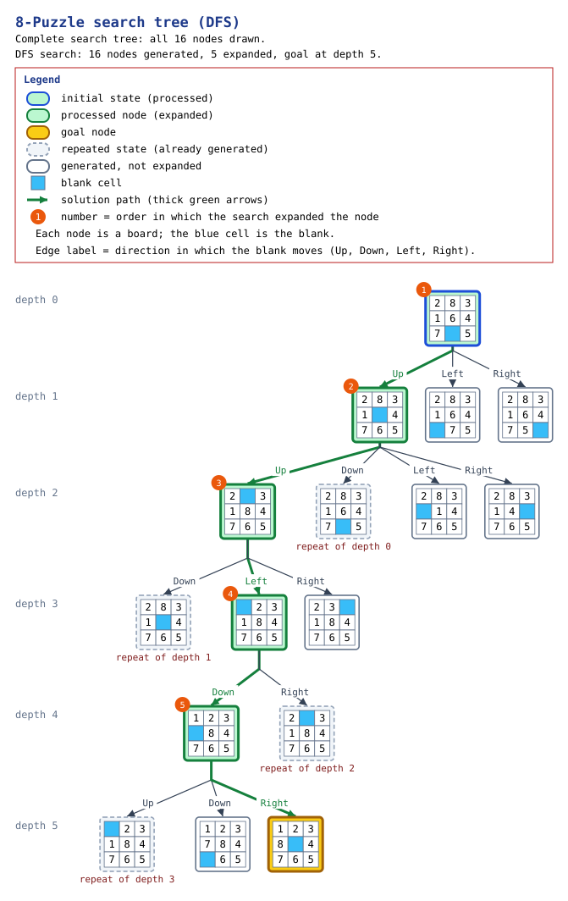
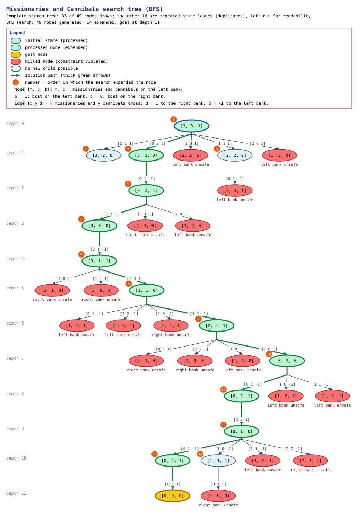
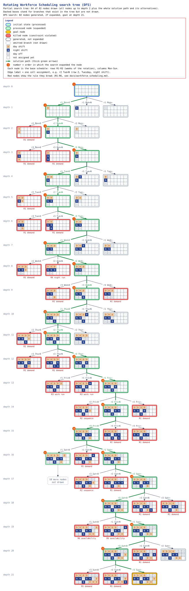

# ia_detyrat_semestrale

Artificial Intelligence 2026 — Assignment 1: Uninformed Search Techniques
([assignment text](https://github.com/adrianymeri/Artificial-Intelligence-2026/blob/main/Detyra1.md)).

| # | Problem | Required algorithm | Status |
|---|---|---|---|
| 1 | Social Golfers Problem | Depth First Search (DFS) with Backtracking | Implemented ([docs](docs/social_golfers.md)) |
| 2 | Sudoku Solver (Easy / Medium / Hard) | Breadth First Search (BFS) with Backtracking | Implemented ([docs](docs/sudoku.md)) |
| 3 | Latin Square | Iterative Deepening DFS (IDDFS) with Backtracking | Implemented ([docs](docs/latin_square.md)) |
| 4 | Search Trees: 8-Puzzle, Missionaries and Cannibals, Rotating Workforce Scheduling | Search-tree construction (BFS / DFS) | Implemented ([docs](docs/search_trees.md)) |

All search algorithms are implemented by hand; no external solver libraries
are used. The final verification of the whole project (requirements coverage,
test results, re-checked metrics, assumptions and limitations) is in
[docs/final_report.md](docs/final_report.md).

## Technologies

* Python 3.10+ (developed and tested with Python 3.13.1)
* Standard library only for the implementation
* pytest for automated tests

## Dependencies

* Runtime: none beyond the Python standard library (`argparse`, `collections`,
  `dataclasses`, `itertools`, `json`, `math`, `pathlib`, `time`, ...).
* Tests: `pytest` (see `requirements.txt`).
* Optional: `Pillow`, only to export the PNG version of the search-tree
  diagrams (SVG and Graphviz DOT need nothing extra).

## Installation

```bash
python -m venv .venv
.venv\Scripts\activate          # Windows (use: source .venv/bin/activate on Linux/macOS)
pip install -r requirements.txt
```

## Project Structure

```
main.py                      CLI entry point (one subcommand per problem)
social_golfers/              Problem 1
  model.py                   CSP configuration and theoretical bounds
  solver.py                  DFS with backtracking, pruning, statistics
  validator.py               independent schedule validator
  objective.py               objective function f(S) and penalty V(S)
  landscape.py               theoretical search-landscape formulas
  report.py                  text output (schedule table, statistics)
  cli.py                     command-line options
sudoku/                      Problem 2
  model.py                   grid parsing, units, initial validation
  solver.py                  BFS (FIFO queue) with backtracking, statistics
  validator.py               independent solution validator
  objective.py               objective function V(x) + E(x)
  landscape.py               theoretical search-landscape figures
  puzzles.py                 Easy / Medium / Hard puzzles, measured classification
  report.py, cli.py          text output and command-line options
latin_square/                Problem 3
  model.py                   grid parsing, validation, reduced form
  solver.py                  IDDFS with backtracking, per-iteration statistics
  validator.py               independent Latin square validator
  objective.py               objective function V(x) + E(x)
  landscape.py               theoretical formulas, literature counts
  report.py, cli.py          text output and command-line options
search_trees/                Problem 4
  core.py                    explicit search-tree construction (BFS/DFS, duplicates, statistics)
  visualization.py           node selection, text tree and Mermaid diagram
  graphics.py                graphical diagrams: SVG, PNG (optional Pillow), Graphviz DOT
  report.py, cli.py          statistics output and command-line options
  eight_puzzle/              8-Puzzle model and validator
  missionaries_cannibals/    Missionaries and Cannibals model and validator
  workforce_scheduling/      Rotating Workforce Scheduling model and validator
tests/                       pytest test suites
docs/                        detailed documentation per problem
  assets/search_trees/       generated search-tree diagrams (SVG, PNG, DOT)
requirements.txt
pytest.ini
```

## Running

All problems run through one entry point, `python main.py <problem> [options]`;
`python main.py --help` lists the problems and `python main.py <problem> --help`
lists the options. Each problem package can also be run on its own, e.g.
`python -m sudoku -d hard`.

### Problem 1 — Social Golfers (`golfers`)

```bash
python main.py golfers --help
python main.py golfers -g 8 -p 4                        # 32 golfers, groups of 4
python main.py golfers -g 3 -p 3                        # 9 golfers, solved optimally (4 weeks)
python main.py golfers -g 8 -p 4 -w 5 --max-nodes 100000 --time-limit 30
python main.py golfers -g 3 -p 2 --count-solutions       # count all schedules
```

Options of `golfers`:

| Option | Meaning | Default |
|---|---|---|
| `-g`, `--groups` | groups per week | 8 |
| `-p`, `--size` | golfers per group | 4 |
| `-n`, `--golfers` | total golfers (must equal g × p) | g × p |
| `-w`, `--weeks` | target number of weeks | theoretical upper bound ⌊(n−1)/(p−1)⌋ |
| `--max-nodes` | limit on expanded states (0 = unlimited) | 2,000,000 |
| `--time-limit` | limit in seconds (0 = unlimited) | 60 |
| `--no-symmetry-breaking` | do not fix week 1 or order the weeks | off |
| `--count-solutions` | count all target-length schedules instead of stopping at the first | off |

The package can also be run directly: `python -m social_golfers -g 3 -p 3`.

Exit codes: `0` success, `1` independent validation failed, `2` invalid parameters.

### Problem 2 — Sudoku (`sudoku`)

```bash
python main.py sudoku --help
python main.py sudoku -d easy                           # or medium / hard
python main.py sudoku -d hard --show-path               # print the solution path
python main.py sudoku -d hard --order row-major         # compare variable orders
python main.py sudoku --puzzle "53..7....6..195....98....6.8...6...34..8.3..17...2...6.6....28....419..5....8..79"
python main.py sudoku --file puzzle.txt --count-solutions
```

Options of `sudoku`:

| Option | Meaning | Default |
|---|---|---|
| `-d`, `--difficulty` | predefined puzzle: easy, medium, hard | easy |
| `--puzzle` / `--file` | custom puzzle (81 cells, `.` or `0` = empty) | — |
| `--order` | cell expanded by each state: `mrv` or `row-major` | mrv |
| `--count-solutions` | find all solutions instead of stopping at the first | off |
| `--max-states` | limit on expanded states (0 = unlimited) | 1,000,000 |
| `--max-queue` | limit on queue size (0 = unlimited) | 2,000,000 |
| `--time-limit` | seconds (0 = unlimited) | 60 |
| `--show-path` | print the assignments leading to the solution | off |

Exit codes: `0` solved and validated, `1` no solution / limit reached / validation failed, `2` invalid puzzle or parameters.

### Problem 3 — Latin Square (`latin`)

```bash
python main.py latin --help
python main.py latin -n 5                               # reduced form (default)
python main.py latin -n 4 --no-symmetry-breaking        # search the full empty grid
python main.py latin -n 5 --no-symmetry-breaking --step 5
python main.py latin -n 5 --count-solutions             # 56 reduced squares
python main.py latin -n 3 --prefill ". . 1/. 1 ./1 . ." # completion (extension)
```

Options of `latin`:

| Option | Meaning | Default |
|---|---|---|
| `-n`, `--size` | order of the square | 5 |
| `--no-symmetry-breaking` | do not fix the first row and column | off |
| `--prefill` | extension: complete a partial grid (rows separated by `/`, `.` = empty) | — |
| `--step` | depth-limit increment (last limit is always the full depth) | 1 |
| `--count-solutions` | count all squares in the last iteration | off |
| `--max-nodes` | limit on nodes over all iterations (0 = unlimited) | 20,000,000 |
| `--time-limit` | seconds (0 = unlimited) | 120 |
| `--hide-iterations` | do not print the per-iteration table | off |

Exit codes: `0` solved and validated, `1` no solution / limit reached, `2` invalid input.

### Problem 4 — Search Trees (`eight-puzzle`, `missionaries`, `workforce`)

```bash
python main.py eight-puzzle                                  # default board, BFS
python main.py eight-puzzle --initial "8 6 7 / 2 5 4 / 3 _ 1" --goal "1 2 3 / 4 5 6 / 7 8 _"
python main.py missionaries -m 3 -c 3 -b 2 --mermaid tree.md
python main.py workforce --config my_rules.json
```

Options shared by `eight-puzzle`, `missionaries` and `workforce`:

| Option | Meaning | Default |
|---|---|---|
| `--strategy` | `bfs` or `dfs` | bfs (workforce: dfs) |
| `--max-depth` | do not expand nodes at this depth | none |
| `--max-nodes` | limit on tree nodes (0 = unlimited) | 1,000,000 |
| `--time-limit` | seconds (0 = unlimited) | 60 |
| `--no-duplicate-detection` | tree search (requires `--max-depth`) | off |
| `--explore-all` | keep building after the first goal | off |
| `--tree-depth` / `--tree-nodes` | size of the printed / drawn partial tree | 3 / 40 |
| `--graph STEM` | write a graphical diagram `STEM.svg`, `STEM.png`, `STEM.dot` | — |
| `--mermaid FILE` | write a depth-limited Mermaid diagram | — |
| `--no-solution-path` | draw only the depth-limited part (no forced solution path) | off |

Problem options: `eight-puzzle --initial --goal`; `missionaries -m -c -b`;
`workforce --config FILE.json`. Exit codes: `0` solved and validated,
`1` no solution / limit reached, `2` invalid input.

## Testing

```bash
python -m pytest            # all tests
python -m pytest -v tests/test_social_golfers.py
python -m pytest -v tests/test_sudoku.py
python -m pytest -v tests/test_latin_square.py
python -m pytest -v tests/test_search_tree_core.py tests/test_eight_puzzle.py tests/test_missionaries_cannibals.py tests/test_workforce_scheduling.py
```

## Example Outputs

Excerpts of real runs (full outputs also print the theoretical landscape and
the search statistics).

`python main.py golfers -g 3 -p 3`:

```
Best schedule (4 weeks):
Week    | Group 1 | Group 2 | Group 3
-------------------------------------
Week 1  | 0,1,2   | 3,4,5   | 6,7,8
Week 2  | 0,3,6   | 1,4,7   | 2,5,8
Week 3  | 0,4,8   | 1,5,6   | 2,3,7
Week 4  | 0,5,7   | 1,3,8   | 2,4,6
```

`python main.py sudoku -d medium`:

```
Solution:
5 1 9 | 7 4 8 | 6 3 2
7 8 3 | 6 5 2 | 4 1 9
4 2 6 | 1 3 9 | 8 7 5
------+-------+------
3 5 7 | 9 8 6 | 2 4 1
2 6 4 | 3 1 7 | 5 9 8
1 9 8 | 5 2 4 | 3 6 7
------+-------+------
9 7 5 | 8 6 3 | 1 2 4
8 3 2 | 4 9 1 | 7 5 6
6 4 1 | 2 7 5 | 9 8 3
```

`python main.py latin -n 5`:

```
Latin square:
1 2 3 4 5
2 1 4 5 3
3 4 5 1 2
4 5 2 3 1
5 3 1 2 4
```

`python main.py missionaries`:

```
Solution (11 crossings):
  d= 0 start      (3,3,L) 3M3C [boat] ~~~       0M0C
  d= 1 0M2C to R  (3,1,R) 3M1C       ~~~ [boat] 0M2C
  d= 2 0M1C to L  (3,2,L) 3M2C [boat] ~~~       0M1C
  d= 3 0M2C to R  (3,0,R) 3M0C       ~~~ [boat] 0M3C
  d= 4 0M1C to L  (3,1,L) 3M1C [boat] ~~~       0M2C
  d= 5 2M0C to R  (1,1,R) 1M1C       ~~~ [boat] 2M2C
  d= 6 1M1C to L  (2,2,L) 2M2C [boat] ~~~       1M1C
  d= 7 2M0C to R  (0,2,R) 0M2C       ~~~ [boat] 3M1C
  d= 8 0M1C to L  (0,3,L) 0M3C [boat] ~~~       3M0C
  d= 9 0M2C to R  (0,1,R) 0M1C       ~~~ [boat] 3M2C
  d=10 0M1C to L  (0,2,L) 0M2C [boat] ~~~       3M1C
  d=11 0M2C to R  (0,0,R) 0M0C       ~~~ [boat] 3M3C
Independent validation: PASSED
```

## Problem 1 — Social Golfers Problem

Schedule `n = g × p` golfers into `g` groups of `p` for as many weeks as
possible so that no two golfers share a group twice.

* **Model:** CSP with variables `x[t][k][s]` (golfer in slot `s` of group `k`
  in week `t`), domains `{0, …, n−1}`, hard constraints C1–C4 (one group per
  golfer per week, group size `p`, `g` groups per week, no repeated pair).
* **Objective:** maximise `f(S)`, the length of the longest valid prefix of the
  schedule; penalty `V(S)` counts repeated pair meetings.
* **Landscape:** theoretical counts (`n^(n·w)`, `(n!)^w`, partitions per week
  `n!/((p!)^g g!)`, canonical schedules `C(P−1, w−1)`) and measured statistics
  (expanded states, backtracks, rejections by reason, branching factors,
  validity ratio, depth).
* **Algorithm:** DFS with backtracking, bitmask constraint checks, group and
  week forward checking, sound symmetry breaking, node/time limits.
* **Validation:** an independent validator re-checks every week, group, golfer
  and pair.

Measured results (2,000,000-state limit):

| Instance | Upper bound | Weeks found | Proven optimal | States expanded |
|---|---|---|---|---|
| 9 golfers (3 × 3) | 4 | 4 | yes | 27 |
| 16 golfers (4 × 4) | 5 | 5 | yes | 64 |
| 12 golfers (4 × 3) | 5 | 4 | yes (exhaustive) | 906,200 |
| 32 golfers (8 × 4) | 10 | 5 | no (limit reached) | 2,000,000 |

Full documentation: [docs/social_golfers.md](docs/social_golfers.md).

## Problem 2 — Sudoku Solver

* **Model:** CSP with 81 variables (cells), domains `{1..9}` (clues fixed),
  27 `AllDifferent` constraints (rows, columns, boxes). Invalid puzzles are
  rejected with a message naming the repeated digit and unit.
* **Objective:** minimise `Φ(x) = V(x) + E(x)`: constraint violations plus
  empty cells; `Φ = 0` exactly for a solution.
* **Landscape:** theoretical bounds (`9^E`, initial domain product, candidate
  counts) and measured statistics (expanded/generated states, invalid partial
  states, dead ends, queue size per level, branching factors).
* **Algorithm:** genuine BFS over a FIFO `deque`; every state fills one cell
  (MRV or row-major); conflicting digits and dead ends (forward check) are
  discarded and the search resumes from the next queued alternative
  (backtracking); parent links rebuild the solution path.
* **Difficulty:** assigned from measured MRV-BFS effort, not clue count.

Measured results (MRV ordering, default limits):

| Puzzle | Clues | States expanded | Backtracks | Max queue | Measured difficulty |
|---|---|---|---|---|---|
| Easy | 30 | 51 | 0 | 1 | easy |
| Medium | 27 | 100 | 3 | 4 | medium |
| Hard | 21 | 17,136 | 1,799 | 826 | hard |

Full documentation: [docs/sudoku.md](docs/sudoku.md).

## Problem 3 — Latin Square

* **Model:** CSP with `n²` cell variables, domains `{1..n}`, `AllDifferent` on
  every row and column.
* **Objective:** minimise `Φ(x) = V(x) + E(x)` (repeated values in rows and
  columns plus empty cells); `Φ = 0` exactly for a Latin square.
* **Landscape:** theoretical counts (`n^(n²)`, `(n!)^n`, unpruned tree and
  IDDFS sizes, literature counts `L(n)`, `R(n)`) and measured nodes per depth
  limit, cutoffs, backtracks, repeated-work ratio.
* **Algorithm:** genuine IDDFS (depth limits 0, 1, 2, …, D), depth-limited DFS
  with early rejection and explicit undo (backtracking); stops early when an
  iteration exhausts its tree without a cutoff. Symmetry breaking (reduced
  form) is on by default.
* **Validation:** independent validator; exhaustive counts reproduce the known
  numbers of Latin squares (576 for n = 4, 9,408 reduced squares for n = 6).

Measured results (step 1):

| n | Mode | Iterations | Nodes visited | Last iteration | Time |
|---|---|---|---|---|---|
| 3 | reduced | 5 | 19 | 6 | < 0.01 s |
| 4 | reduced | 10 | 161 | 10 | < 0.01 s |
| 5 | reduced | 17 | 4,914 | 29 | 0.02 s |
| 6 | reduced | 26 | 1,194,077 | 52 | 10.2 s |
| 5 | full grid | 26 | 13,505,923 | 38 | 115 s |

Full documentation: [docs/latin_square.md](docs/latin_square.md).

## Problem 4 — Search Trees

One shared engine builds an explicit search tree (node ids, parent-child
links, actions, depths, statuses: expanded, goal, duplicate, invalid,
depth-limit, dead end) with BFS or DFS, duplicate detection, limits and
statistics, and draws graphical diagrams (SVG, PNG, Graphviz DOT) plus text
and Mermaid views that always include the complete solution path.

| Problem | Model | Measured result |
|---|---|---|
| 8-Puzzle | board permutation, blank moves Up/Down/Left/Right, inversion-parity solvability | default: 5-move optimal solution (54 nodes); full space 181,440 boards; hardest instance 31 moves (BFS) vs 40,757 (DFS) |
| Missionaries and Cannibals | `(m, c, boat)`, loads of 1..K people, safety on both banks; unsafe crossings shown as invalid nodes | 11 crossings; 15 reachable states; 4/4/2 has no solution; 4 optimal solutions in the tree search |
| Rotating Workforce Scheduling | cyclic base schedule (3 employees × 7 days, shifts D/N/off) with **assumed** rules R1–R6 (demand, forbidden N→D, run lengths, workload, availability) | DFS finds a valid schedule in 82 nodes; 1,864 schedules in total |

Search trees generated by the implemented searches (green = processed node,
blue frame = initial state, gold = goal, red = killed node, light blue = no
new child, grey dashed = repeated state, white = not expanded, dashed box =
omitted branch; orange numbers = expansion order; thick green arrows =
solution path; click an image for full size; PNG and Graphviz DOT versions
are in [`docs/assets/search_trees/`](docs/assets/search_trees/)):

**8-Puzzle (DFS)** — complete tree: 16 nodes, goal at depth 5



**Missionaries and Cannibals (BFS)** — complete graph-search tree, node `[m, c, b]`, edge `[x y d]`; repeated-state leaves left out



**Rotating Workforce Scheduling (DFS)** — partial: depth ≤ 2 plus the complete 21-step solution path



The partial BFS tree of the 8-Puzzle is in [docs/eight_puzzle.md](docs/eight_puzzle.md).

Documentation: [overview](docs/search_trees.md), [8-Puzzle](docs/eight_puzzle.md),
[Missionaries and Cannibals](docs/missionaries_cannibals.md),
[Rotating Workforce Scheduling](docs/workforce_scheduling.md) (with the list of
assumptions — the assignment does not define this problem's constraints).

## Known Limitations

* Social Golfers: for 32 golfers, uninformed DFS finds 5 weeks; the known
  optimum of 10 weeks is out of reach without heuristics or algebraic
  constructions (see Section 16 of the documentation).
* Sudoku: BFS keeps a whole level of the search tree in memory; with
  row-major ordering the Hard puzzle needs about 426 MiB, and the 17-clue
  extra puzzle exceeds the default limits.
* Latin Square: every goal lies at the maximum depth, so all IDDFS iterations
  before the last are exhaustive; the reduced form works up to n = 6, the full
  grid up to n = 5.
* Search Trees: uninformed BFS/DFS only (no heuristics); the workforce rules
  are assumptions because the assignment does not specify them; large trees
  are drawn as partial views (depth-limited, plus the complete solution path,
  with omitted branches marked); the diagrams use a built-in layout because
  Graphviz was not installed (the DOT sources can be rendered with Graphviz).
