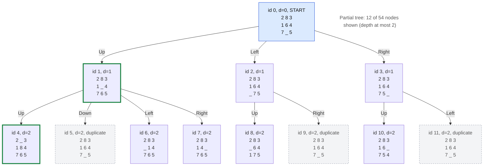

# Problem 4A — 8-Puzzle (Search Tree)

Shared engine, terminology and visualization rules: [search_trees.md](search_trees.md).
Numbers marked **measured** come from running this implementation; times
depend on the machine.

## 1. Problem Description

A 3×3 board holds the tiles 1–8 and one empty cell (the blank). A move slides
a tile adjacent to the blank into it. Given an initial and a goal board, find
a sequence of moves that turns the initial board into the goal board, and
show the search tree that the search builds.

## 2. Mathematical Model

The state space is the set of permutations of `{0, 1, …, 8}` (0 = blank):
`|S| = 9! = 362,880`. A move swaps the blank with an orthogonal neighbour.

**Solvability (inversion parity).** An *inversion* is a pair of tiles (blank
ignored) that appear in the wrong order when the board is read row by row.
A horizontal move does not change the reading order; a vertical move moves one
tile past exactly two others, changing the inversion count by −2, 0 or +2. So
the parity of the inversion count is invariant, and the states split into two
classes of `9!/2 = 181,440` boards; a goal is reachable exactly when it has
the same parity as the initial board.

## 3. Problem Representation

[`search_trees/eight_puzzle/model.py`](../search_trees/eight_puzzle/model.py):
a state is a tuple of 9 integers read row by row, `0` = blank. Input accepts 9
tiles separated by spaces, commas or `/`, with `0` or `_` for the blank. Output
shows boards as `2 8 3 / 1 6 4 / 7 _ 5` (text) or as three lines (Mermaid).

## 4. Variables and Domains

| Element | Definition |
|---|---|
| Variables | the content of the 9 cells, `x_0 … x_8` |
| Domains | `{0, …, 8}`, with the global constraint that `x` is a permutation |
| Actions | `Up`, `Down`, `Left`, `Right` — the direction in which the **blank** moves |
| Legal actions | moves that keep the blank on the board: 2 in a corner, 3 on an edge, 4 in the centre |

## 5. Initial State

Default (Nilsson's textbook example): `2 8 3 / 1 6 4 / 7 _ 5`. Any board can be
given with `--initial`. Boards are validated: exactly 9 tiles, each of 0..8
once.

## 6. Goal State

Default: `1 2 3 / 8 _ 4 / 7 6 5` (blank in the centre); configurable with
`--goal`. Goal test: the state equals the goal board.

## 7. Constraints and Validity Checks

* a board must be a permutation of 0..8 (`check_board`);
* a move must keep the blank inside the 3×3 board — off-board moves are not
  applicable actions and are not generated;
* initial and goal must have the same inversion parity for a solution to exist
  (reported before the search; the search itself confirms it).

## 8. Objective

Find a path from the initial to the goal board; BFS returns a path with the
minimum number of moves (all moves cost 1).

## 9. State Space and Search-Tree Analysis

**Theoretical:**

| Quantity | Value |
|---|---|
| Boards | `9! = 362,880` |
| Reachable from any board | `9!/2 = 181,440` |
| Branching factor | 2, 3 or 4; average over blank positions `(4·2 + 4·3 + 1·4)/9 = 2.667` |
| Tree size without duplicate detection | `O(b^d)`; at depth `d` up to `4·3^(d−1)` nodes |

**Measured** (`python main.py eight-puzzle …`, duplicate detection on unless stated):

| Instance | Strategy | Solution depth | Tree nodes | Expanded | Duplicates | Unique states | Max frontier | Raw BF | Effective BF | Time |
|---|---|---|---|---|---|---|---|---|---|---|
| default | BFS | **5** | 54 | 20 | 19 | 35 | 14 | 2.650 | 1.700 | 0.001 s |
| default | DFS | 5 | 16 | 5 | 4 | 12 | 6 | 3.000 | 2.200 | 0.001 s |
| default, tree search (`--no-duplicate-detection --max-depth 5`) | BFS | 5 | 115 | 41 | 0 | 35 | 73 | 2.780 | 2.780 | 0.002 s |
| default, whole tree (`--explore-all`, no node limit) | BFS | 5 | 483,837 | 181,439 | 302,397 | **181,440** | 25,193 | 2.667 | 1.000 | 9.8 s |
| hard: `8 6 7 / 2 5 4 / 3 _ 1` → `1 2 3 / 4 5 6 / 7 8 _` | BFS | **31** | 483,564 | 181,347 | 302,125 | 181,439 | 25,134 | 2.667 | 1.001 | 10.4 s |
| same hard instance | DFS | **40,757** | 122,799 | 44,185 | 48,967 | 73,832 | 29,648 | 2.779 | 1.671 | 2.0 s |
| unsolvable: `2 1 3 / 4 5 6 / 7 8 _` → `1 2 3 / 4 5 6 / 7 8 _` | BFS | none | 483,841 | 181,440 | 302,401 | **181,440** | 24,054 | 2.667 | 1.000 | 10.1 s |

New (non-duplicate) states per depth when the whole tree of the default
initial board is built (measured):

```
depth:  0 1 2  3  4  5  6  7   8   9  10  11  12   13   14   15   16   17   18    19    20    21    22    23    24    25    26   27   28  29  30 31
states: 1 3 5 10 14 28 39 75 105 197 269 507 707 1313 1754 3191 4091 7159 8433 13702 14545 21540 19752 25191 18417 19311 10192 7629 2189 941 127  3
```

Observations:

* The whole tree contains exactly **181,440** distinct boards — the size of
  one parity class — confirming the theory. The farthest boards from the
  default initial board are 31 moves away (3 boards).
* The unsolvable instance exhausts all 181,440 boards of its class without
  reaching the goal, which lies in the other class.
* Duplicate detection matters even for tiny trees: without it the depth-5 tree
  has 115 nodes instead of 54, and every move can be undone immediately.
* **BFS finds the optimal 31-move solution; DFS returns a valid but absurd
  40,757-move path** for the same instance. DFS follows one branch as deep as
  it goes; with duplicate detection it is complete on this finite space but
  gives no guarantee about path length.

## 10. Algorithm Used

BFS (default): the FIFO frontier explores the tree level by level, so the first
goal generated is a shallowest one — an optimal solution for unit-cost moves.
DFS (`--strategy dfs`) is available for comparison. See the pseudocode in
[search_trees.md](search_trees.md).

## 11. Pseudocode (problem-specific part)

```
function EXPAND(board):
    (r, c) ← position of the blank
    for (action, dr, dc) in [(Up,−1,0), (Down,1,0), (Left,0,−1), (Right,0,1)]:
        if 0 ≤ r+dr < 3 and 0 ≤ c+dc < 3:
            yield (action, board with blank and tile at (r+dr, c+dc) swapped)
```

## 12. Implementation and Search-Tree Visualization

| File | Responsibility |
|---|---|
| [`model.py`](../search_trees/eight_puzzle/model.py) | parsing, validation, moves, inversions, solvability, labels |
| [`validator.py`](../search_trees/eight_puzzle/validator.py) | independent replay of a solution with its own move arithmetic |

Mermaid diagram generated by
`python main.py eight-puzzle --tree-depth 2 --tree-nodes 20 --mermaid tree.md`
(**partial tree**: depth ≤ 2 of a 54-node tree):



The same tree as text (depth ≤ 2):

```
[0] d=0 2 8 3 / 1 6 4 / 7 _ 5  (INITIAL; on solution path)
|-- [1] d=1 Up -> 2 8 3 / 1 _ 4 / 7 6 5  (on solution path)
|   |-- [4] d=2 Up -> 2 _ 3 / 1 8 4 / 7 6 5  (on solution path)
|   |-- [5] d=2 Down -> 2 8 3 / 1 6 4 / 7 _ 5  (duplicate; state already generated at depth 0)
|   |-- [6] d=2 Left -> 2 8 3 / _ 1 4 / 7 6 5
|   `-- [7] d=2 Right -> 2 8 3 / 1 4 _ / 7 6 5
|-- [2] d=1 Left -> 2 8 3 / 1 6 4 / _ 7 5
|   |-- [8] d=2 Up -> 2 8 3 / _ 6 4 / 1 7 5
|   `-- [9] d=2 Right -> 2 8 3 / 1 6 4 / 7 _ 5  (duplicate; state already generated at depth 0)
`-- [3] d=1 Right -> 2 8 3 / 1 6 4 / 7 5 _
    |-- [10] d=2 Up -> 2 8 3 / 1 6 _ / 7 5 4
    `-- [11] d=2 Left -> 2 8 3 / 1 6 4 / 7 _ 5  (duplicate; state already generated at depth 0)
(Partial view: 12 of 54 nodes, depth <= 2; 42 nodes not shown.)
```

## 13. Complexity Analysis

* BFS time and space: `O(b^d)` nodes for solution depth `d`; with duplicate
  detection bounded by the 181,440 reachable states (measured peak frontier
  about 25,000 nodes).
* DFS space: the frontier holds the siblings along the current path
  (measured peak 29,648 nodes on the hard instance, because the path became
  40,757 moves long).
* Each expansion costs O(1) (at most 4 moves, each a tuple copy of 9 cells).

## 14. Test Results

`python -m pytest -v tests/test_eight_puzzle.py`: **32 tests, 32 passed,
0 failed** (16.4 s; most of it is the full-state-space test).

| Test class | Tests | What is verified |
|---|---|---|
| `TestModel` | 18 | parsing, invalid boards, legal actions for all 9 blank positions, moves, inversions, solvability, parity invariant over a depth-6 tree |
| `TestSearchTree` | 7 | BFS optimal 5-move solution, DFS valid solution, parent-child relationships (every edge replays), duplicate detection, already-solved board, full 181,440-state exhaustion of an unsolvable instance, branching factors |
| `TestValidator` | 3 | off-board moves, wrong final board, unknown actions, malformed boards |
| `TestCLI` | 4 | default run with Mermaid output, unsolvable custom boards, invalid board, tree search without a depth limit rejected |

## 15. Execution Example

```
python main.py eight-puzzle
```

```
8-Puzzle search tree
  Initial: 2 8 3 / 1 6 4 / 7 _ 5  (inversions 11)
  Goal:    1 2 3 / 8 _ 4 / 7 6 5  (inversions 7)
  Boards: 362,880 in total, 181,440 reachable from any board; average branching factor 2.667
  Solvable (same inversion parity): yes
...
Solution (5 moves of the blank): Up, Up, Left, Down, Right
  d=0: 2 8 3 / 1 6 4 / 7 _ 5
  d=1: 2 8 3 / 1 _ 4 / 7 6 5
  d=2: 2 _ 3 / 1 8 4 / 7 6 5
  d=3: _ 2 3 / 1 8 4 / 7 6 5
  d=4: 1 2 3 / _ 8 4 / 7 6 5
  d=5: 1 2 3 / 8 _ 4 / 7 6 5
Independent validation: PASSED
```

```
python main.py eight-puzzle --initial "8 6 7 / 2 5 4 / 3 _ 1" --goal "1 2 3 / 4 5 6 / 7 8 _"   # 31 moves
python main.py eight-puzzle --strategy dfs
python main.py eight-puzzle --no-duplicate-detection --max-depth 5
```

## 16. Limitations

* No heuristic search (A*, IDA*): the assignment covers uninformed search.
  BFS of the hardest instances therefore visits almost the whole class of
  181,440 boards (about 10 s, building an explicit tree of about 480,000 nodes).
* The explicit tree stores every node including duplicate leaves, which
  costs more memory than a plain graph search would.
* DFS solutions are valid but usually far from optimal.
