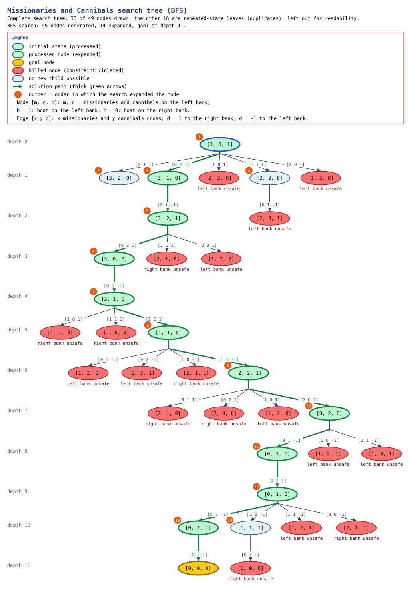

# Problem 4B — Missionaries and Cannibals (Search Tree)

Shared engine, terminology and visualization rules: [search_trees.md](search_trees.md).
Numbers marked **measured** come from running this implementation.

## 1. Problem Description

Three missionaries and three cannibals stand on the left bank of a river with
one boat that holds at most two people. Everyone must reach the right bank.
The boat cannot cross empty, and on neither bank may the cannibals outnumber
the missionaries while at least one missionary is there.

The implementation supports any number of missionaries `M`, cannibals `C` and
boat capacity `K` (`-m`, `-c`, `-b`); the standard problem is `M = C = 3`,
`K = 2`.

## 2. Mathematical Model

State `s = (m, c, b)`: missionaries and cannibals on the **left** bank and the
boat side (`b = 1` left, `b = 0` right). The right bank holds `(M − m, C − c)`.

A crossing carries `(Δm, Δc)` people with `Δm, Δc ≥ 0` and
`1 ≤ Δm + Δc ≤ K`:

```
b = 1 (left → right):  (m, c, 1) → (m − Δm, c − Δc, 0)     requires Δm ≤ m, Δc ≤ c
b = 0 (right → left):  (m, c, 0) → (m + Δm, c + Δc, 1)     requires Δm ≤ M − m, Δc ≤ C − c
```

Safety constraints on the resulting state:

```
(m = 0) ∨ (m ≥ c)                          left bank
(M − m = 0) ∨ (M − m ≥ C − c)              right bank
```

## 3. Problem Representation

[`search_trees/missionaries_cannibals/model.py`](../search_trees/missionaries_cannibals/model.py):
the state is the tuple `(m, c, b)`. Actions are labelled `ΔmMΔcC to R|L`, e.g.
`0M2C to R` = two cannibals cross to the right bank. Text output shows both
banks, e.g. `(3,1,R) 3M1C       ~~~ [boat] 0M2C`.

## 4. Variables and Domains

| Element | Definition |
|---|---|
| Variables | `m ∈ {0..M}`, `c ∈ {0..C}`, `b ∈ {0, 1}` |
| State space | `(M+1)(C+1)·2` combinations: 32 for 3/3 |
| Boat loads | all `(Δm, Δc)` with `1 ≤ Δm + Δc ≤ K`: 5 for `K = 2` — `0M1C, 0M2C, 1M0C, 1M1C, 2M0C` |

## 5. Initial State

`(M, C, 1)` = `(3, 3, L)`. The initial state must itself be safe
(e.g. `M = 1, C = 2` is rejected).

## 6. Goal State

`(0, 0, 0)` = everyone and the boat on the right bank.

## 7. Constraints and Validity Checks

| Check | Effect in the search tree |
|---|---|
| a crossing may not take people who are not on the boat's bank (`0 ≤ m ≤ M`, `0 ≤ c ≤ C`) | not an applicable action; not generated |
| boat carries 1..K people | only such loads are generated |
| safety on both banks | a crossing into an unsafe state is an **invalid transition**: shown in the tree as a red leaf with the reason (e.g. `left bank: 3 cannibals > 2 missionaries`) and never expanded |
| repeated state | **duplicate** leaf, never expanded |

The independent validator
([`validator.py`](../search_trees/missionaries_cannibals/validator.py))
checks a single state (`validate_state`) and a whole solution path
(`validate_solution`): start and end states, safety of every state, the boat
changing sides every step, people moving in the boat's direction only, and the
boat capacity.

## 8. Objective

Reach the goal with the minimum number of crossings; BFS returns such a path.

## 9. State Space and Search-Tree Analysis

**Theoretical (3/3/2):** 32 combinations of `(m, c, b)`, of which 20 are
safe; 5 boat loads, so at most 5 transitions per state.

**Measured:**

| Configuration | Strategy | Crossings | Tree nodes | Expanded | Valid transitions | Invalid | Duplicates | Dead ends | Unique states | Raw BF | Valid BF | Effective BF |
|---|---|---|---|---|---|---|---|---|---|---|---|---|
| 3/3/2 | BFS | **11** | 46 | 13 | 28 | 17 | 14 | 2 | 15 | 3.462 | 2.154 | 1.077 |
| 3/3/2 | DFS | 11 | 43 | 12 | 26 | 16 | 12 | 1 | 15 | 3.500 | 2.167 | 1.167 |
| 3/3/2, whole tree (`--explore-all`) | BFS | 11 | 49 | 14 | 30 | 18 | 16 | 3 | **15** | 3.429 | 2.143 | 1.000 |
| 3/3/2, tree search to depth 11 (`--no-duplicate-detection --max-depth 11 --explore-all`) | BFS | 11 | **30,641** | 7,727 | 19,221 | 11,419 | 0 | 0 | 15 | 3.965 | 2.488 | 2.488 |
| 4/4/2 | BFS | **none** | 40 | 11 | 22 | 17 | 12 | 4 | 11 | 3.545 | 2.000 | 0.909 |
| 4/4/3 | BFS | 9 | 106 | 18 | 51 | 54 | 31 | 4 | 21 | 5.833 | 2.833 | 1.111 |
| 5/5/3 | BFS | 11 | 132 | 22 | 61 | 70 | 36 | 5 | 26 | 5.955 | 2.773 | 1.136 |
| 2/2/2 | BFS | 5 | 24 | 8 | 18 | 5 | 9 | 3 | 10 | 2.875 | 2.250 | 1.125 |

New states per depth (3/3/2, whole tree): `1, 3, 1, 1, 1, 1, 1, 1, 1, 1, 2, 1`.

Observations:

* Only **15 of the 20 safe states are reachable** from the initial state.
* The state graph is almost a single corridor: after depth 1, every level adds
  one or two new states. The search tree is small because duplicate detection
  cuts every return crossing.
* Without duplicate detection the tree up to depth 11 has **30,641 nodes** and
  contains **4 goal nodes** — the four known optimal 11-crossing solutions.
  With duplicate detection the tree keeps one path to every state, so it shows
  one of them.
* 4 missionaries, 4 cannibals and a boat of 2 have **no solution**: the search
  exhausts the 11 reachable states.

## 10. Algorithm Used

BFS by default (shortest solution); DFS with `--strategy dfs`. Shared
pseudocode: [search_trees.md](search_trees.md).

## 11. Pseudocode (problem-specific part)

```
function EXPAND((m, c, b)):
    sign ← −1 if b = left else +1
    for (Δm, Δc) in loads with 1 ≤ Δm + Δc ≤ K:
        s' ← (m + sign·Δm, c + sign·Δc, 1 − b)
        if s' outside 0..M / 0..C: continue                 // not applicable
        if not SAFE(s'): yield INVALID(action, s', reason)  // shown, never expanded
        else:            yield (action, s')
```

## 12. Implementation and Search-Tree Visualization

### Complete search tree (BFS)



Files: [SVG](assets/search_trees/missionaries_cannibals_tree.svg) ·
[PNG](assets/search_trees/missionaries_cannibals_tree.png) ·
[Graphviz DOT](assets/search_trees/missionaries_cannibals_tree.dot) — generated with
`python main.py missionaries --explore-all --tree-depth 11 --tree-nodes 60 --graph docs/assets/search_trees/missionaries_cannibals_tree`.

Notation (as in the legend): a node `[m, c, b]` gives the missionaries and
cannibals on the left bank and the boat side (`b = 1` left, `b = 0` right); an
edge `[x y d]` moves `x` missionaries and `y` cannibals, to the right bank if
`d = 1` and to the left bank if `d = -1`.

This is the **complete** tree of graph search (BFS with duplicate detection,
`--explore-all`): from `[3, 3, 1]` at depth 0 to the goal `[0, 0, 0]` at
depth 11, with the 11-crossing solution in thick green. The 14 expanded nodes
are numbered in the order BFS expanded them. Red nodes are killed: the
crossing would leave missionaries outnumbered (the caption names the bank),
so they are never expanded. Light-blue nodes are expanded but have no new
child (every crossing leads to an unsafe or repeated state). The 16
repeated-state leaves (crossings back to a state already generated) are left
out of the drawing for readability; the caption states this, and they are
listed in the text tree below.

Without duplicate detection the tree is infinite (every crossing can be
undone); up to depth 11 it already has 30,641 nodes.

How to read the diagrams (the legend is also printed in each image):
green = processed (expanded) node, blue frame = initial state, gold = goal
node, red = killed node (constraint violated, with the reason underneath),
light blue = no new child possible (dead end), grey dashed = repeated state
(already generated), white = generated but not expanded (the search stopped
first), white dashed box = omitted branch with its node count. The orange
number on a node is the order in which the search expanded it; thick green
arrows are the solution path; the ruler on the left gives the depth; edge
labels are the actions.

<details>
<summary>Same tree as text, including the 16 repeated states</summary>

```
[0] d=0 (3,3,L) 3M3C [boat] ~~~       0M0C  (INITIAL; on solution path)
|-- [1] d=1 0M1C to R -> (3,2,R) 3M2C       ~~~ [boat] 0M1C  (dead end)
|   `-- [6] d=2 0M1C to L -> (3,3,L) 3M3C [boat] ~~~       0M0C  (duplicate; state already generated at depth 0)
|-- [2] d=1 0M2C to R -> (3,1,R) 3M1C       ~~~ [boat] 0M2C  (on solution path)
|   |-- [7] d=2 0M1C to L -> (3,2,L) 3M2C [boat] ~~~       0M1C  (on solution path)
|   |   |-- [12] d=3 0M1C to R -> (3,1,R) 3M1C       ~~~ [boat] 0M2C  (duplicate; state already generated at depth 1)
|   |   |-- [13] d=3 0M2C to R -> (3,0,R) 3M0C       ~~~ [boat] 0M3C  (on solution path)
|   |   |   |-- [17] d=4 0M1C to L -> (3,1,L) 3M1C [boat] ~~~       0M2C  (on solution path)
|   |   |   |   |-- [19] d=5 0M1C to R -> (3,0,R) 3M0C       ~~~ [boat] 0M3C  (duplicate; state already generated at depth 3)
|   |   |   |   |-- [20] d=5 1M0C to R -> (2,1,R) 2M1C       ~~~ [boat] 1M2C  (invalid; right bank: 2 cannibals > 1 missionaries)
|   |   |   |   |-- [21] d=5 1M1C to R -> (2,0,R) 2M0C       ~~~ [boat] 1M3C  (invalid; right bank: 3 cannibals > 1 missionaries)
|   |   |   |   `-- [22] d=5 2M0C to R -> (1,1,R) 1M1C       ~~~ [boat] 2M2C  (on solution path)
|   |   |   |       |-- [23] d=6 0M1C to L -> (1,2,L) 1M2C [boat] ~~~       2M1C  (invalid; left bank: 2 cannibals > 1 missionaries)
|   |   |   |       |-- [24] d=6 0M2C to L -> (1,3,L) 1M3C [boat] ~~~       2M0C  (invalid; left bank: 3 cannibals > 1 missionaries)
|   |   |   |       |-- [25] d=6 1M0C to L -> (2,1,L) 2M1C [boat] ~~~       1M2C  (invalid; right bank: 2 cannibals > 1 missionaries)
|   |   |   |       |-- [26] d=6 1M1C to L -> (2,2,L) 2M2C [boat] ~~~       1M1C  (on solution path)
|   |   |   |       |   |-- [28] d=7 0M1C to R -> (2,1,R) 2M1C       ~~~ [boat] 1M2C  (invalid; right bank: 2 cannibals > 1 missionaries)
|   |   |   |       |   |-- [29] d=7 0M2C to R -> (2,0,R) 2M0C       ~~~ [boat] 1M3C  (invalid; right bank: 3 cannibals > 1 missionaries)
|   |   |   |       |   |-- [30] d=7 1M0C to R -> (1,2,R) 1M2C       ~~~ [boat] 2M1C  (invalid; left bank: 2 cannibals > 1 missionaries)
|   |   |   |       |   |-- [31] d=7 1M1C to R -> (1,1,R) 1M1C       ~~~ [boat] 2M2C  (duplicate; state already generated at depth 5)
|   |   |   |       |   `-- [32] d=7 2M0C to R -> (0,2,R) 0M2C       ~~~ [boat] 3M1C  (on solution path)
|   |   |   |       |       |-- [33] d=8 0M1C to L -> (0,3,L) 0M3C [boat] ~~~       3M0C  (on solution path)
|   |   |   |       |       |   |-- [37] d=9 0M1C to R -> (0,2,R) 0M2C       ~~~ [boat] 3M1C  (duplicate; state already generated at depth 7)
|   |   |   |       |       |   `-- [38] d=9 0M2C to R -> (0,1,R) 0M1C       ~~~ [boat] 3M2C  (on solution path)
|   |   |   |       |       |       |-- [39] d=10 0M1C to L -> (0,2,L) 0M2C [boat] ~~~       3M1C  (on solution path)
|   |   |   |       |       |       |   |-- [44] d=11 0M1C to R -> (0,1,R) 0M1C       ~~~ [boat] 3M2C  (duplicate; state already generated at depth 9)
|   |   |   |       |       |       |   `-- [45] d=11 0M2C to R -> (0,0,R) 0M0C       ~~~ [boat] 3M3C  (GOAL)
|   |   |   |       |       |       |-- [40] d=10 0M2C to L -> (0,3,L) 0M3C [boat] ~~~       3M0C  (duplicate; state already generated at depth 8)
|   |   |   |       |       |       |-- [41] d=10 1M0C to L -> (1,1,L) 1M1C [boat] ~~~       2M2C  (dead end)
|   |   |   |       |       |       |   |-- [46] d=11 0M1C to R -> (1,0,R) 1M0C       ~~~ [boat] 2M3C  (invalid; right bank: 3 cannibals > 2 missionaries)
|   |   |   |       |       |       |   |-- [47] d=11 1M0C to R -> (0,1,R) 0M1C       ~~~ [boat] 3M2C  (duplicate; state already generated at depth 9)
|   |   |   |       |       |       |   `-- [48] d=11 1M1C to R -> (0,0,R) 0M0C       ~~~ [boat] 3M3C  (duplicate; state already generated at depth 11)
|   |   |   |       |       |       |-- [42] d=10 1M1C to L -> (1,2,L) 1M2C [boat] ~~~       2M1C  (invalid; left bank: 2 cannibals > 1 missionaries)
|   |   |   |       |       |       `-- [43] d=10 2M0C to L -> (2,1,L) 2M1C [boat] ~~~       1M2C  (invalid; right bank: 2 cannibals > 1 missionaries)
|   |   |   |       |       |-- [34] d=8 1M0C to L -> (1,2,L) 1M2C [boat] ~~~       2M1C  (invalid; left bank: 2 cannibals > 1 missionaries)
|   |   |   |       |       |-- [35] d=8 1M1C to L -> (1,3,L) 1M3C [boat] ~~~       2M0C  (invalid; left bank: 3 cannibals > 1 missionaries)
|   |   |   |       |       `-- [36] d=8 2M0C to L -> (2,2,L) 2M2C [boat] ~~~       1M1C  (duplicate; state already generated at depth 6)
|   |   |   |       `-- [27] d=6 2M0C to L -> (3,1,L) 3M1C [boat] ~~~       0M2C  (duplicate; state already generated at depth 4)
|   |   |   `-- [18] d=4 0M2C to L -> (3,2,L) 3M2C [boat] ~~~       0M1C  (duplicate; state already generated at depth 2)
|   |   |-- [14] d=3 1M0C to R -> (2,2,R) 2M2C       ~~~ [boat] 1M1C  (duplicate; state already generated at depth 1)
|   |   |-- [15] d=3 1M1C to R -> (2,1,R) 2M1C       ~~~ [boat] 1M2C  (invalid; right bank: 2 cannibals > 1 missionaries)
|   |   `-- [16] d=3 2M0C to R -> (1,2,R) 1M2C       ~~~ [boat] 2M1C  (invalid; left bank: 2 cannibals > 1 missionaries)
|   `-- [8] d=2 0M2C to L -> (3,3,L) 3M3C [boat] ~~~       0M0C  (duplicate; state already generated at depth 0)
|-- [3] d=1 1M0C to R -> (2,3,R) 2M3C       ~~~ [boat] 1M0C  (invalid; left bank: 3 cannibals > 2 missionaries)
|-- [4] d=1 1M1C to R -> (2,2,R) 2M2C       ~~~ [boat] 1M1C  (dead end)
|   |-- [9] d=2 0M1C to L -> (2,3,L) 2M3C [boat] ~~~       1M0C  (invalid; left bank: 3 cannibals > 2 missionaries)
|   |-- [10] d=2 1M0C to L -> (3,2,L) 3M2C [boat] ~~~       0M1C  (duplicate; state already generated at depth 2)
|   `-- [11] d=2 1M1C to L -> (3,3,L) 3M3C [boat] ~~~       0M0C  (duplicate; state already generated at depth 0)
`-- [5] d=1 2M0C to R -> (1,3,R) 1M3C       ~~~ [boat] 2M0C  (invalid; left bank: 3 cannibals > 1 missionaries)
(Complete tree: all 49 nodes shown.)
```

</details>

## 13. Complexity Analysis

* With duplicate detection the work is linear in the number of reachable
  states (15) times the number of boat loads (5).
* Without it the tree grows as `O(b^d)`: measured 30,641 nodes at depth 11
  with an effective branching factor of 2.49.
* Larger `M`, `C`, `K` grow the state space as `O(M·C)` and the loads as
  `O(K²)`.

## 14. Test Results

`python -m pytest -v tests/test_missionaries_cannibals.py`: **23 tests,
23 passed, 0 failed** (0.9 s).

| Test class | Tests | What is verified |
|---|---|---|
| `TestModel` | 9 | invalid configurations (negative counts, capacity 0, no people, booleans, unsafe initial state), safety of both banks, boat loads, invalid crossings with reasons, no crossing takes absent people |
| `TestSearchTree` | 9 | 11-crossing BFS solution validated, DFS solution validated, 15 reachable / 20 safe / 32 total states, invalid nodes are never expanded and every valid node is safe, 4/4/2 unsolvable, 1/1/2, 2/2/2, 4/4/3 and 5/5/3 solved and validated |
| `TestValidator` | 2 | state errors and path errors (wrong end, over capacity, boat not changing sides) |
| `TestCLI` | 3 | default run, unsolvable configuration, invalid configuration |

## 15. Execution Example

```
python main.py missionaries
```

```
Solution (11 crossings):
  d= 0 start      (3,3,L) 3M3C [boat] ~~~       0M0C
  d= 1 0M2C to R  (3,1,R) 3M1C       ~~~ [boat] 0M2C
  d= 2 0M1C to L  (3,2,L) 3M2C [boat] ~~~       0M1C
  d= 3 0M2C to R  (3,0,R) 3M0C       ~~~ [boat] 0M3C
  d= 4 0M1C to L  (3,1,L) 3M1C [boat] ~~~       0M2C
  d= 5 2M0C to R  (1,1,R) 1M1C       ~~~ [boat] 2M2C
  d= 6 1M1C to L  (2,2,L) 2M2C [boat] ~~~       1M1C
  d= 7 2M0C to R  (0,2,R) 0M2C       ~~~ [boat] 3M1C
  d= 8 0M1C to L  (0,3,L) 0M3C [boat] ~~~       3M0C
  d= 9 0M2C to R  (0,1,R) 0M1C       ~~~ [boat] 3M2C
  d=10 0M1C to L  (0,2,L) 0M2C [boat] ~~~       3M1C
  d=11 0M2C to R  (0,0,R) 0M0C       ~~~ [boat] 3M3C
Independent validation: PASSED
```

```
python main.py missionaries -m 4 -c 4 -b 2        # no solution (exit code 1)
python main.py missionaries -m 5 -c 5 -b 3        # 11 crossings
python main.py missionaries --no-duplicate-detection --max-depth 11 --explore-all --tree-depth 2
```

## 16. Limitations

* With duplicate detection the tree keeps only the first path to each state, so
  it shows one optimal solution; use tree search with a depth limit to see all
  of them.
* The standard rule is modelled: on each bank, missionaries must not be
  outnumbered when present. Variants (e.g. counting the boat's passengers on
  the arrival bank before they land) are not modelled.
