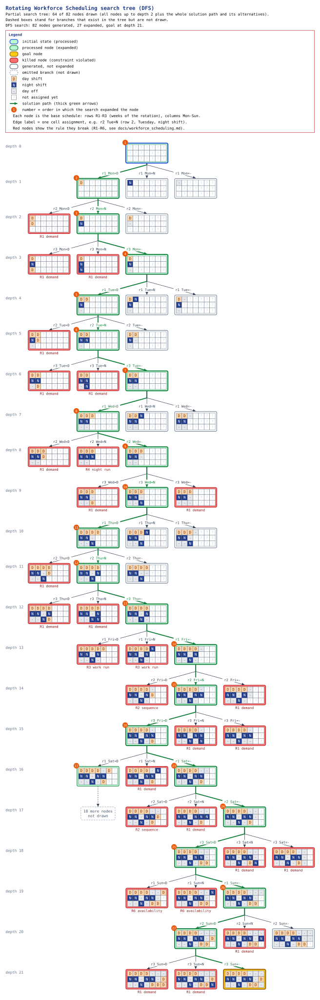

# Problem 4C — Rotating Workforce Scheduling (Search Tree)

Shared engine, terminology and visualization rules: [search_trees.md](search_trees.md).
Numbers marked **measured** come from running this implementation.

## 0. Official Requirement versus Assumptions

**Official (from `Detyra1.md`):** "Construct a Search Tree" for Rotating
Workforce Scheduling. Nothing else is specified — no employees, shifts,
demand, rules or example data. No further material was available in the
repository.

**Missing information:** the number of employees, the shift types, the
scheduling period, the staffing demand, the work rules (rest periods, run
lengths), the workload rules and how availability is expressed.

**Everything below is an assumption of this project**, modelled on the usual
definition of rotating workforce scheduling in the literature (a cyclic base
schedule that every employee follows with a one-week offset). All values are
adjustable through a JSON file (`--config`).

| Id | Assumed rule | Default value |
|---|---|---|
| A1 | Rotating (cyclic) base schedule: `n` rows (weeks) × `days` columns; employee `e` works row `(e + k) mod n` in week `k` | `n = 3` employees, `days = 7` |
| A2 | Shifts: working shifts plus `-` (day off) | `D` (day), `N` (night) |
| R1 | Demand: on each day, exactly `demand[s][d]` rows work shift `s` | `D`: 1 every day; `N`: 1 Mon–Fri, 0 Sat–Sun |
| R2 | Forbidden sequences, checked cyclically (Sunday of the last row is followed by Monday of row 1) | `N → D` (no day shift right after a night) |
| R3 | Maximum consecutive working days (cyclic) | 4 |
| R4 | Maximum consecutive days of the same shift | `N`: 2 |
| R5 | Workload distribution: working days per row | between 3 and 5 |
| R6 | Availability: `(employee, absolute day)` pairs on which the employee must be off (absolute day = `week · days + day` in the cycle) | employee 1 is unavailable on Sunday of week 1 |

## 1. Problem Description

Assign a shift or a day off to every cell of a cyclic base schedule so that all
rules R1–R6 hold, and show the search tree that this construction produces.
Because the schedule rotates, every employee eventually works every row, which
spreads the workload fairly.

## 2. Mathematical Model

Variables `x_{w,d} ∈ {D, N, -}` for rows `w = 0..n−1` and days `d = 0..6`.
The rotation turns the matrix into one cyclic sequence of `T = 7n` days:
`y_t = x_{⌊t/7⌋, t mod 7}`, with `y_{T} ≡ y_0`.

```
R1  |{w : x_{w,d} = s}| = demand[s][d]                    for every day d and shift s
R2  (y_t, y_{t+1}) ∉ Forbidden                            for every t (cyclic)
R3  every cyclic run of working days in y has length ≤ 4
R4  every cyclic run of N in y has length ≤ 2
R5  3 ≤ |{d : x_{w,d} ≠ -}| ≤ 5                           for every row w
R6  x_{(e + ⌊t/7⌋) mod n, t mod 7} = -                    for every unavailable (e, t)
```

This is a CSP; the search tree enumerates partial assignments.

## 3. Problem Representation

[`search_trees/workforce_scheduling/model.py`](../search_trees/workforce_scheduling/model.py):

* **State:** the tuple of shifts assigned so far. Cells are filled **column by
  column** (all rows' Monday, then all rows' Tuesday, …), so each day's demand
  is complete as soon as its column is filled.
* **Action:** assign one value to the next cell, labelled e.g. `r2 Mon=N`.
* **Display:** the partial schedule with `?` for unassigned cells, e.g.
  `D?????? | N?????? | -??????`.

## 4. Variables and Domains

| Element | Definition |
|---|---|
| Variables | `x_{w,d}`, `n · days = 21` cells |
| Domains | `{D, N, -}` |
| Branching | 3 transitions per expanded node (one per value), valid or invalid |

## 5. Initial State

The empty schedule `()` (all 21 cells unassigned).

## 6. Goal State

A complete assignment (depth 21). Every transition is checked against every
rule that can already be evaluated, so a node at depth 21 satisfies R1–R6.

## 7. Constraints, Validity Checks and State Transitions

When a value is written into cell `(w, d)` the transition is **invalid** if:

* R6: the cell belongs to an unavailable employee and the value is a shift;
* R1: the column already has `demand[s][d]` rows on shift `s`, or too many days
  off for the demand to be met;
* R2: the cyclic predecessor or successor cell is assigned and forms a
  forbidden pair;
* R3 / R4: the run of assigned working days (or the same shift) through this
  cell, extended in both directions, is too long;
* R5: the row exceeds the maximum, or can no longer reach the minimum with its
  remaining unassigned days.

An invalid transition is drawn as a red leaf with the first violated rule and
never expanded. The independent validator
([`validator.py`](../search_trees/workforce_scheduling/validator.py)) re-checks
a **complete** schedule from scratch (columns, cyclic sequence, cyclic runs,
rows, and availability mapped through the rotation).

**Duplicate-state detection:** the engine's duplicate check is active, but a
state is a prefix of the fixed cell order, so two different paths can never
produce the same state. The measured number of duplicates is therefore 0.

## 8. Objective

Find a feasible schedule (any schedule satisfying R1–R6). `--explore-all`
enumerates all of them.

## 9. Search-Space and Search-Tree Analysis

**Theoretical:** `3^21 = 10,460,353,203` complete assignments; a tree without
pruning would have `Σ_{d=0..21} 3^d ≈ 1.57 × 10^10` nodes.

**Measured:**

| Run | Strategy | Result | Tree nodes | Expanded | Valid transitions | Invalid | Duplicates | Dead ends | Max frontier | Valid BF | Time |
|---|---|---|---|---|---|---|---|---|---|---|---|
| default | DFS | schedule at depth 21 | **82** | 27 | 39 | 42 | 0 | 2 | 14 | 1.444 | 0.003 s |
| default | BFS | schedule at depth 21 | 24,622 | 8,207 | 10,303 | 14,318 | 0 | 708 | 2,099 | 1.255 | 1.0 s |
| default, whole tree (`--explore-all`) | DFS | **1,864 schedules** | 30,910 | 10,303 | 12,166 | 18,743 | 0 | 941 | 15 | 1.181 | 1.4 s |
| without R6 (`unavailable: []`), whole tree | DFS | 2,796 schedules | 36,739 | 12,246 | 15,041 | 21,697 | 0 | 944 | 15 | 1.228 | 2.0 s |
| `min_work_per_row: 5` (unsatisfiable) | DFS | **none** | 9,463 | 3,154 | 3,153 | 6,309 | 0 | 806 | 13 | 1.000 | 0.5 s |

Invalid transitions in the whole default tree, by the first rule they break:
R1 demand 14,049 · R6 availability 2,520 · R2 forbidden sequence 1,209 ·
R3 run length 521 · R5 workload 270 · R4 night run 174.

Valid partial states per depth (whole default tree):
`1, 3, 6, 6, 16, 28, 24, 60, 96, 72, 184, 304, 240, 582, 902, 654, 1074, 1494, 1260, 1198, 2099, 1864`.
The pattern repeats every 3 levels (one column = 3 rows): demand prunes
hardest when a column is completed.

Observations:

* Incremental checking shrinks `10^10` assignments to a tree of about 31,000
  nodes in total.
* DFS reaches a schedule after 82 nodes, while BFS must build almost every
  valid partial schedule of depths 0–20 first (goals exist only at depth 21).
  DFS's frontier stays tiny (≤ 15); BFS's grows to 2,099.
* Removing the availability rule R6 increases the number of schedules from
  1,864 to 2,796.
* With `min_work_per_row = 5` there is no schedule: 12 working cells cannot
  give each of 3 rows at least 5 working days. DFS proves this after 9,463
  nodes.

## 10. Algorithm Used

DFS by default: all goals are at the maximum depth 21, so DFS finds one
quickly with a small frontier. BFS (`--strategy bfs`) is available for
comparison. Shared pseudocode: [search_trees.md](search_trees.md).

## 11. Pseudocode (problem-specific part)

```
function EXPAND(state):
    (w, d) ← next cell in column-major order
    for v in [D, N, -]:
        reason ← FIRST_VIOLATION(state, w, d, v)     // R6, R1, R2, R3, R4, R5
        yield (action "r{w+1} {day}={v}", state + (v,), valid = reason is empty, reason)
```

## 12. Implementation and Search-Tree Visualization

| File | Responsibility |
|---|---|
| [`model.py`](../search_trees/workforce_scheduling/model.py) | `WorkforceConfig` (validated, JSON-loadable), `RotatingWorkforce` search problem, rendering, employee view, diagram style |
| [`validator.py`](../search_trees/workforce_scheduling/validator.py) | independent validator of complete schedules |

### Search tree (DFS, partial)



Files: [SVG](assets/search_trees/workforce_scheduling_tree.svg) ·
[PNG](assets/search_trees/workforce_scheduling_tree.png) ·
[Graphviz DOT](assets/search_trees/workforce_scheduling_tree.dot) — generated with
`python main.py workforce --tree-depth 2 --tree-nodes 20 --graph docs/assets/search_trees/workforce_scheduling_tree`.

Each node is the base schedule as a colour grid: rows R1–R3 (the weeks of the
rotation), columns Monday–Sunday; orange `D` = day shift, dark blue `N` =
night shift, grey `-` = day off, white `?` = not assigned yet. An edge assigns
one cell, e.g. `r2 Tue=N`.

This is a **partial** view of the 82-node DFS tree: every node up to depth 2,
plus the complete solution path from the empty schedule to the first complete
schedule (depth 21) and all three alternatives at every step (64 nodes
drawn). Red nodes break a rule, named underneath (R1 demand, R2 sequence,
R3 work run, R4 night run, R6 availability). White nodes are alternatives DFS
generated but never needed to expand. Node 17 at depth 16 was expanded and
failed; its 18 descendants (expansions 18–22) are summarised by the dashed
"18 more nodes not drawn" box, which is why the numbering jumps from 17 to 23.
The whole tree of all 1,864 schedules has 30,910 nodes and is not drawn.

How to read the diagrams (the legend is also printed in each image):
green = processed (expanded) node, blue frame = initial state, gold = goal
node, red = killed node (constraint violated, with the reason underneath),
light blue = no new child possible (dead end), grey dashed = repeated state
(already generated), white = generated but not expanded (the search stopped
first), white dashed box = omitted branch with its node count. The orange
number on a node is the order in which the search expanded it; thick green
arrows are the solution path; the ruler on the left gives the depth; edge
labels are the actions.

<details>
<summary>Same view as text</summary>

```
[0] d=0 ??????? | ??????? | ???????  (INITIAL; on solution path)
|-- [1] d=1 r1 Mon=D -> D?????? | ??????? | ???????  (on solution path)
|   |-- [4] d=2 r2 Mon=D -> D?????? | D?????? | ???????  (invalid; R1 demand: more than 1 D on day 1)
|   |-- [5] d=2 r2 Mon=N -> D?????? | N?????? | ???????  (on solution path)
|   |   |-- [7] d=3 r3 Mon=D -> D?????? | N?????? | D??????  (invalid; R1 demand: more than 1 D on day 1)
|   |   |-- [8] d=3 r3 Mon=N -> D?????? | N?????? | N??????  (invalid; R1 demand: more than 1 N on day 1)
|   |   `-- [9] d=3 r3 Mon=- -> D?????? | N?????? | -??????  (on solution path)
|   |       |-- [10] d=4 r1 Tue=D -> DD????? | N?????? | -??????  (on solution path)
|   |       |   |-- [13] d=5 r2 Tue=D -> DD????? | ND????? | -??????  (invalid; R1 demand: more than 1 D on day 2)
|   |       |   |-- [14] d=5 r2 Tue=N -> DD????? | NN????? | -??????  (on solution path)
|   |       |   |   |-- [16] d=6 r3 Tue=D -> DD????? | NN????? | -D?????  (invalid; R1 demand: more than 1 D on day 2)
|   |       |   |   |-- [17] d=6 r3 Tue=N -> DD????? | NN????? | -N?????  (invalid; R1 demand: more than 1 N on day 2)
|   |       |   |   `-- [18] d=6 r3 Tue=- -> DD????? | NN????? | --?????  (on solution path)
|   |       |   |       |-- [19] d=7 r1 Wed=D -> DDD???? | NN????? | --?????  (on solution path)
|   |       |   |       |   |-- [22] d=8 r2 Wed=D -> DDD???? | NND???? | --?????  (invalid; R1 demand: more than 1 D on day 3)
|   |       |   |       |   |-- [23] d=8 r2 Wed=N -> DDD???? | NNN???? | --?????  (invalid; R4 more than 2 consecutive N shifts)
|   |       |   |       |   `-- [24] d=8 r2 Wed=- -> DDD???? | NN-???? | --?????  (on solution path)
|   |       |   |       |       |-- [25] d=9 r3 Wed=D -> DDD???? | NN-???? | --D????  (invalid; R1 demand: more than 1 D on day 3)
|   |       |   |       |       |-- [26] d=9 r3 Wed=N -> DDD???? | NN-???? | --N????  (on solution path)
|   |       |   |       |       |   |-- [28] d=10 r1 Thu=D -> DDDD??? | NN-???? | --N????  (on solution path)
|   |       |   |       |       |   |   |-- [31] d=11 r2 Thu=D -> DDDD??? | NN-D??? | --N????  (invalid; R1 demand: more than 1 D on day 4)
|   |       |   |       |       |   |   |-- [32] d=11 r2 Thu=N -> DDDD??? | NN-N??? | --N????  (on solution path)
|   |       |   |       |       |   |   |   |-- [34] d=12 r3 Thu=D -> DDDD??? | NN-N??? | --ND???  (invalid; R1 demand: more than 1 D on day 4)
|   |       |   |       |       |   |   |   |-- [35] d=12 r3 Thu=N -> DDDD??? | NN-N??? | --NN???  (invalid; R1 demand: more than 1 N on day 4)
|   |       |   |       |       |   |   |   `-- [36] d=12 r3 Thu=- -> DDDD??? | NN-N??? | --N-???  (on solution path)
|   |       |   |       |       |   |   |       |-- [37] d=13 r1 Fri=D -> DDDDD?? | NN-N??? | --N-???  (invalid; R3 more than 4 consecutive working days)
|   |       |   |       |       |   |   |       |-- [38] d=13 r1 Fri=N -> DDDDN?? | NN-N??? | --N-???  (invalid; R3 more than 4 consecutive working days)
|   |       |   |       |       |   |   |       `-- [39] d=13 r1 Fri=- -> DDDD-?? | NN-N??? | --N-???  (on solution path)
|   |       |   |       |       |   |   |           |-- [40] d=14 r2 Fri=D -> DDDD-?? | NN-ND?? | --N-???  (invalid; R2 forbidden sequence N->D)
|   |       |   |       |       |   |   |           |-- [41] d=14 r2 Fri=N -> DDDD-?? | NN-NN?? | --N-???  (on solution path)
|   |       |   |       |       |   |   |           |   |-- [43] d=15 r3 Fri=D -> DDDD-?? | NN-NN?? | --N-D??  (on solution path)
|   |       |   |       |       |   |   |           |   |   |-- [46] d=16 r1 Sat=D -> DDDD-D? | NN-NN?? | --N-D??
|   |       |   |       |       |   |   |           |   |   |   `-- ... 18 more nodes not drawn
|   |       |   |       |       |   |   |           |   |   |-- [47] d=16 r1 Sat=N -> DDDD-N? | NN-NN?? | --N-D??  (invalid; R1 demand: more than 0 N on day 6)
|   |       |   |       |       |   |   |           |   |   `-- [48] d=16 r1 Sat=- -> DDDD--? | NN-NN?? | --N-D??  (on solution path)
|   |       |   |       |       |   |   |           |   |       |-- [67] d=17 r2 Sat=D -> DDDD--? | NN-NND? | --N-D??  (invalid; R2 forbidden sequence N->D)
|   |       |   |       |       |   |   |           |   |       |-- [68] d=17 r2 Sat=N -> DDDD--? | NN-NNN? | --N-D??  (invalid; R1 demand: more than 0 N on day 6)
|   |       |   |       |       |   |   |           |   |       `-- [69] d=17 r2 Sat=- -> DDDD--? | NN-NN-? | --N-D??  (on solution path)
|   |       |   |       |       |   |   |           |   |           |-- [70] d=18 r3 Sat=D -> DDDD--? | NN-NN-? | --N-DD?  (on solution path)
|   |       |   |       |       |   |   |           |   |           |   |-- [73] d=19 r1 Sun=D -> DDDD--D | NN-NN-? | --N-DD?  (invalid; R6 availability: employee must be off)
|   |       |   |       |       |   |   |           |   |           |   |-- [74] d=19 r1 Sun=N -> DDDD--N | NN-NN-? | --N-DD?  (invalid; R6 availability: employee must be off)
|   |       |   |       |       |   |   |           |   |           |   `-- [75] d=19 r1 Sun=- -> DDDD--- | NN-NN-? | --N-DD?  (on solution path)
|   |       |   |       |       |   |   |           |   |           |       |-- [76] d=20 r2 Sun=D -> DDDD--- | NN-NN-D | --N-DD?  (on solution path)
|   |       |   |       |       |   |   |           |   |           |       |   |-- [79] d=21 r3 Sun=D -> DDDD--- | NN-NN-D | --N-DDD  (invalid; R1 demand: more than 1 D on day 7)
|   |       |   |       |       |   |   |           |   |           |       |   |-- [80] d=21 r3 Sun=N -> DDDD--- | NN-NN-D | --N-DDN  (invalid; R1 demand: more than 0 N on day 7)
|   |       |   |       |       |   |   |           |   |           |       |   `-- [81] d=21 r3 Sun=- -> DDDD--- | NN-NN-D | --N-DD-  (GOAL)
|   |       |   |       |       |   |   |           |   |           |       |-- [77] d=20 r2 Sun=N -> DDDD--- | NN-NN-N | --N-DD?  (invalid; R1 demand: more than 0 N on day 7)
|   |       |   |       |       |   |   |           |   |           |       `-- [78] d=20 r2 Sun=- -> DDDD--- | NN-NN-- | --N-DD?  (not expanded)
|   |       |   |       |       |   |   |           |   |           |-- [71] d=18 r3 Sat=N -> DDDD--? | NN-NN-? | --N-DN?  (invalid; R1 demand: more than 0 N on day 6)
|   |       |   |       |       |   |   |           |   |           `-- [72] d=18 r3 Sat=- -> DDDD--? | NN-NN-? | --N-D-?  (invalid; R1 demand: day 6 would be understaffed)
|   |       |   |       |       |   |   |           |   |-- [44] d=15 r3 Fri=N -> DDDD-?? | NN-NN?? | --N-N??  (invalid; R1 demand: more than 1 N on day 5)
|   |       |   |       |       |   |   |           |   `-- [45] d=15 r3 Fri=- -> DDDD-?? | NN-NN?? | --N--??  (invalid; R1 demand: day 5 would be understaffed)
|   |       |   |       |       |   |   |           `-- [42] d=14 r2 Fri=- -> DDDD-?? | NN-N-?? | --N-???  (invalid; R1 demand: day 5 would be understaffed)
|   |       |   |       |       |   |   `-- [33] d=11 r2 Thu=- -> DDDD??? | NN--??? | --N????  (not expanded)
|   |       |   |       |       |   |-- [29] d=10 r1 Thu=N -> DDDN??? | NN-???? | --N????  (not expanded)
|   |       |   |       |       |   `-- [30] d=10 r1 Thu=- -> DDD-??? | NN-???? | --N????  (not expanded)
|   |       |   |       |       `-- [27] d=9 r3 Wed=- -> DDD???? | NN-???? | ---????  (invalid; R1 demand: day 3 would be understaffed)
|   |       |   |       |-- [20] d=7 r1 Wed=N -> DDN???? | NN????? | --?????  (not expanded)
|   |       |   |       `-- [21] d=7 r1 Wed=- -> DD-???? | NN????? | --?????  (not expanded)
|   |       |   `-- [15] d=5 r2 Tue=- -> DD????? | N-????? | -??????  (not expanded)
|   |       |-- [11] d=4 r1 Tue=N -> DN????? | N?????? | -??????  (not expanded)
|   |       `-- [12] d=4 r1 Tue=- -> D-????? | N?????? | -??????  (not expanded)
|   `-- [6] d=2 r2 Mon=- -> D?????? | -?????? | ???????  (not expanded)
|-- [2] d=1 r1 Mon=N -> N?????? | ??????? | ???????  (not expanded)
`-- [3] d=1 r1 Mon=- -> -?????? | ??????? | ???????  (not expanded)
(Partial tree: 64 of 82 nodes shown (depth at most 2 plus the solution path).)
```

</details>

## 13. Complexity Analysis

* Worst case `O(3^T)` nodes for `T = n · days` cells; incremental checks prune
  most of it (measured 30,910 nodes for the whole default tree).
* Each transition check costs `O(n + days + T)`: a column count, a row count
  and run scans along the cyclic sequence.
* DFS memory `O(T)` frontier entries per level (measured ≤ 15); BFS memory is
  the width of the widest level (measured 2,099).

## 14. Test Results

`python -m pytest -v tests/test_workforce_scheduling.py`: **30 tests,
30 passed, 0 failed** (4.6 s).

| Test class | Tests | What is verified |
|---|---|---|
| `TestConfig` | 14 | 11 invalid configurations with their messages, availability mapped through the rotation, JSON round trip, JSON errors |
| `TestSearchTree` | 8 | default schedule found at depth 21 and validated, BFS vs DFS, invalid nodes carry a rule and are never expanded, no duplicates by construction, every rule R1–R6 rejects some transition, unsatisfiable configuration, all 1,864 schedules validated, employee rotation view |
| `TestValidator` | 5 | valid schedule, shape and unknown shifts, demand, forbidden sequence including the cyclic wrap-around, run lengths, night runs, workload and availability |
| `TestCLI` | 3 | default run with Mermaid output, unsatisfiable configuration file, invalid configuration file |

## 15. Execution Example

```
python main.py workforce
```

```
Rotating Workforce Scheduling: 3 employees, 7 days per week, shifts D, N and '-' (off)
  Search depth: 21 cells; naive assignments 3^21 = 10,460,353,203
...
Base schedule (row = week of the rotation):
Row   Mon Tue Wed Thu Fri Sat Sun
R1      D   D   D   D   -   -   -
R2      N   N   -   N   N   -   D
R3      -   -   N   -   D   D   -

Rotation (each employee moves to the next row every week):
Employee 1: DDDD--- | NN-NN-D | --N-DD-
Employee 2: NN-NN-D | --N-DD- | DDDD---
Employee 3: --N-DD- | DDDD--- | NN-NN-D
Independent validation: PASSED
```

Example configuration file (all keys optional; omitted keys keep the defaults):

```json
{
  "employees": 3,
  "days": 7,
  "shifts": ["D", "N"],
  "demand": {"D": [1, 1, 1, 1, 1, 1, 1], "N": [1, 1, 1, 1, 1, 0, 0]},
  "forbidden_sequences": [["N", "D"]],
  "max_consecutive_work": 4,
  "max_consecutive_same": {"N": 2},
  "min_work_per_row": 3,
  "max_work_per_row": 5,
  "unavailable": [[0, 6]]
}
```

```
python main.py workforce --config my_rules.json
python main.py workforce --explore-all --tree-depth 2      # count all schedules
python main.py workforce --strategy bfs
```

## 16. Limitations

* All rules R1–R6 and the default data are **assumptions**; the assignment
  does not specify them.
* Rules found in real rotating-workforce instances but not modelled here:
  minimum run lengths of work and days-off blocks, weekend-off requirements,
  more than one employee per row (teams), shift start times.
* The example is deliberately small (21 cells) so that complete trees can be
  enumerated; larger instances grow exponentially and would need constraint
  propagation or heuristics.
